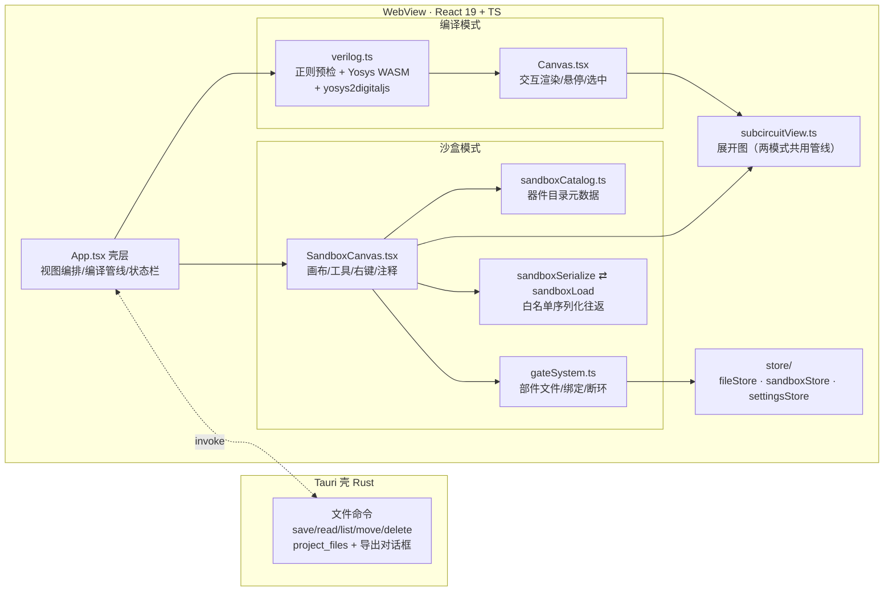

# 架构总览 / Architecture

> 面向开发者的信息参考 + 关键决策解释。
> Informational reference and decision explanations for developers.

---

## 中文

### 进程模型

**宿主（主路径）＝VS Code 扩展壳**：Extension Host（Node，`extension/`）开一个 `WebviewPanel` 装 React 前端，
文件 IO／另存为／剪贴板由 `workspace.fs` / `showSaveDialog` / `env.clipboard` 承担，
前端与宿主之间隔一条**带 id 配对的 JSON 消息通道**。**Yosys 以 WASM、DigitalJS 以 UMD bundle 静态装载**
（`public/`），综合与仿真全部发生在 webview 内，完全离线。
Tauri 2 桌面壳（Rust 侧极薄：文件 IO 命令 + 原生保存对话框）**仍在仓内、作历史/可回退宿主**。
两种宿主都不变的一件事：前端⛔ 直连宿主 API，全部走 `src/lib/host/` 那一层探测（见 `MIGRATION_VSCODE.md`）。

### 分层与数据流

| 层 | 模块 | 职责 |
|----|------|------|
| 壳层 | `App.tsx` | 视图模式编排、编译管线触发、跨模式桥（复制到沙盒）、全局快捷键 |
| 领域库 | `lib/*` | 综合（verilog.ts）、部件系统（gateSystem.ts）、序列化往返（sandboxSerialize/sandboxLoad）、展开渲染（subcircuitView）、镜像（cellMirror）、走线（wireRouting）、仿真时钟（simClock）、参数契约（deviceParams）、注释（annotationCell）、表达式引擎（exprToCircuit） |
| 状态 | `store/*` | 发布-订阅 + `useSyncExternalStore`；文件双写（localStorage 缓存 + Tauri project_files） |
| 组件 | `components/*` | 画布、面板、对话框族（Prompt/Confirm 统一收口） |

**核心数据形态**：沙盒一等公民 = joint cells 白名单 JSON（`.djs`）；编译产物 = circuit JSON
（devices/connectors/subcircuits）；两者转换必须经 `deviceParams` 的**三处对称清单**
（序列化/回读/电路互转共用一份字段表）。

### 关键决策（ADR 摘要）

1. **白名单序列化，禁 `paper.model.toJSON()`**——digitaljs cell 的 attrs 挂 `Vector3vl` 运行时对象、
   嵌套 Subcircuit 挂活 Graph，joint 深拷贝会**挂死**。所有存档走 `sandboxSerialize`。
2. **构造期参数单一清单**（deviceParams.ts）——digitaljs 把 bits/polarity/groups/slice/… 列为
   「运行时不可改」，事后 set 被回滚；改动这类参数走 **reconfigureCell 重建**（保 id/位置/连线）。
3. **展开图同管线**——两模式钻取共用 `renderCircuitView`（提升为顶层 + io_ui + elk），
   「所见 = 编译所得」；端口名模糊匹配只存在于降级补线（宁可 skip + 计数，不猜端口）。
4. **循环依赖三层防御**（R123）——物化链祖先守卫（resolveDefCells）→ 平铺表断环
   （cellsToCircuitJson 三分支：回边 `__cycle` 空壳 / 加-建-删回溯 / 空壳占位登记）→
   放置拦截 + 常驻警告。digitaljs `_makeGraph` 按 celltype 直查平铺表且无环守卫，
   **表里每个被引用的 celltype 必有项**是渲染不崩的不变量。
5. **镜像走模型级**（cellMirror）——joint 无原生 flip；`mirror {h,v}` 属性随存档往返，
   视图形变换落在 body 元素上，注释类文本**随板翻转**、器件标签回正。
6. **端口 id = IO net**——digitaljs Subcircuit 用 IO cell 的 net 作 port id；空名/重名 IO
   必须经**同一套**唯一化算法（subcircuit.dedupeIoNets），任何第二实现都是断线隐患。
7. **闸门即验收**（见 DEVELOPMENT.md）——每能力必配 Playwright 闸门 + 变异台架；
   三态判定（pass/fail/未验证），「没判成」不许混进绿灯。

### 前端事件仲裁

全局快捷键注册表（`lib/shortcuts.ts`）单一真源：`matchesCombo` 归一修饰键组合；
输入控件（INPUT/TEXTAREA/CodeMirror focus）内只放行 EDITOR_SAFE 子集；沙盒自身监听
先注册并 preventDefault 消费，App 全局处理器检查 `defaultPrevented` 短路——
新增按键必须走注册表，禁止裸 addEventListener 处理组合键。

## English

### Process model

The **primary host is a VS Code extension shell**: an Extension Host (Node, `extension/`) opens a
`WebviewPanel` that carries the React front-end, with file IO, Save-As and clipboard served by
`workspace.fs` / `showSaveDialog` / `env.clipboard`, and an **id-paired JSON message channel** between
them. **Yosys runs as WASM and DigitalJS as a UMD bundle from `public/`** — synthesis and simulation
live entirely in the webview, fully offline. The Tauri 2 shell (thin Rust side: file-IO commands +
native save dialog) is still in-tree as the **legacy/fallback host**. What does not change across
hosts: the front-end never touches host APIs directly — it goes through the detection layer in
`src/lib/host/` (see `MIGRATION_VSCODE.md`).

### Layering

- **Shell** `App.tsx`: view orchestration, compile pipeline, cross-mode bridges, global keys.
- **Domain libs** `lib/*`: synthesis, part system & bindings, whitelist serialization round-trip,
  shared drill-down renderer, model-level mirroring, global wire routing, sim clock,
  constructor-time parameter contract, sticky notes, expression→circuit engine.
- **State** `store/*`: publish/subscribe + `useSyncExternalStore`; files dual-written
  (localStorage cache + Tauri `project_files`).

### Key decisions (ADR digest)

1. **Whitelist serialization only** — `paper.model.toJSON()` hangs: digitaljs cells carry
   `Vector3vl` runtime objects and live nested Graphs in attrs.
2. **Constructor-time params are a single-list contract** (`deviceParams.ts`) — changes go
   through rebuild (`reconfigureCell`) preserving id/position/wires.
3. **One drill-down pipeline for both modes** — "what you expand is what you compiled";
   fuzzy port matching exists only in the degraded re-wiring path (skip + count, never guess).
4. **Circular parts: three-layer defense** (R123) — ancestor guard in materialization,
   cycle-broken flat table (back-edges renamed `foo__cycle` to empty shells, add-build-delete
   chain backtracking, empty-ref placeholder registration), plus placement refusal and a
   persistent warning bar. *Every referenced celltype must exist in the flat table* is the
   invariant that keeps digitaljs `_makeGraph` (unguarded recursion) from crashing.
5. **Model-level mirroring** — `mirror {h,v}` persists with saves; note text flips with the
   board on purpose, device labels stay upright.
6. **Port id = IO net** — IO net uniquification must stay a single algorithm
   (`dedupeIoNets`); a second implementation is a silent wire-anchoring hazard.
7. **Gates are acceptance** — every capability ships with a Playwright gate + mutation probe;
   three-state verdicts; "not verified" never counts as green.

---

↩️ [文档地图 Index](./README.md) ｜ 深入沙盒管线：[SANDBOX_DEV.md](./SANDBOX_DEV.md)
